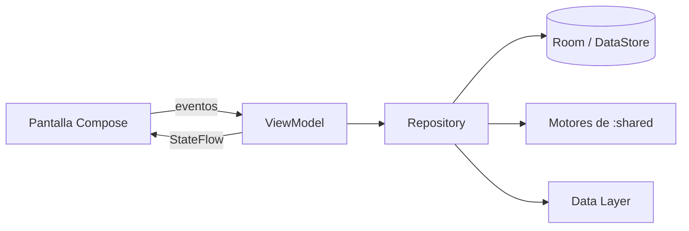
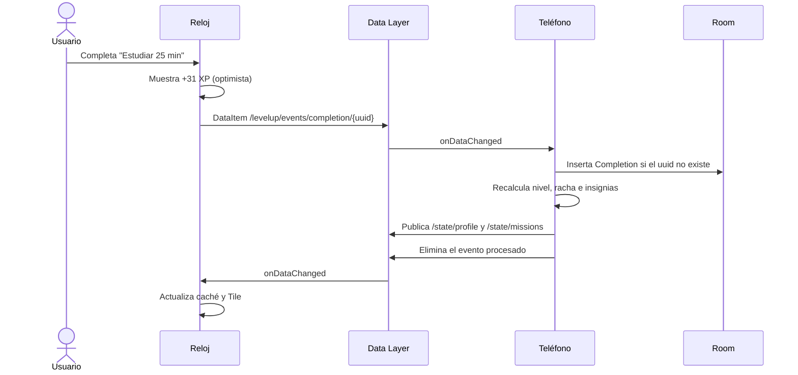

# LevelUp · Plan de implementación

| | |
|---|---|
| **Proyecto** | PROYECTO-DDI · AppWear |
| **Caso de estudio** | LevelUp — Convierte tu vida en un videojuego |
| **Plataformas** | Wear OS (reloj) + Android (teléfono) |
| **Lenguaje** | Kotlin |
| **Versión del documento** | 1.1 · 29 de octubre de 2026 |
| **Fecha de entrega** | Miércoles 18 de noviembre de 2026 |
| **Integrantes** | Bazaldua Hernandez Juan Miguel · Vasquez Flores Andrea · Torres Luna Jorge Hummberto |

El calendario de trabajo, las tareas por fase y los criterios de aceptación están en [ROADMAP.md](ROADMAP.md).

---

## 1. Descripción general

LevelUp convierte las tareas diarias en **misiones**. Cada misión completada otorga **experiencia (XP)** y **monedas**. La XP sube el **nivel** del jugador, las monedas se canjean por **recompensas** que define el propio usuario y ciertos logros desbloquean **insignias**.

El sistema tiene dos aplicaciones que se sincronizan entre sí:

- **Reloj (Wear OS):** es el control del juego. Desde ahí el usuario ve sus misiones del día, las completa con un toque, usa un temporizador de estudio que valida la misión al terminar y recibe la celebración de cada logro con animación y vibración.
- **Teléfono (Android):** es el centro de organización. Desde ahí se crean y editan misiones, se consultan estadísticas e insignias y se administran las recompensas.

## 2. Objetivos

**Objetivo general.** Desarrollar en Kotlin una aplicación de gamificación de hábitos para Wear OS con app complementaria en Android, que aproveche las capacidades propias del reloj: temporizador en primer plano, vibración y Tiles.

**Objetivos específicos.**

1. Implementar un sistema de misiones con XP, niveles, rachas, monedas, insignias y recompensas.
2. Sincronizar el progreso entre reloj y teléfono mediante la **Wearable Data Layer API**, también cuando el reloj estuvo desconectado.
3. Validar misiones automáticamente con un **temporizador de enfoque** en el reloj.
4. Mostrar el progreso fuera de la app con un **Tile**.
5. Mantener la lógica del juego en un módulo compartido y cubierto por pruebas unitarias.

## 3. Alcance

El alcance está ajustado a la fecha de entrega del **18 de noviembre de 2026**, unas tres semanas de desarrollo. Las funcionalidades se priorizan con el método MoSCoW. Una fase no empieza funcionalidades *Could* hasta cerrar todas las *Must*.

| Prioridad | Funcionalidades |
|---|---|
| **Must** | CRUD de misiones · XP y niveles · completar misiones desde teléfono y reloj · sincronización · lista de misiones en el reloj · temporizador de estudio · celebración con vibración · catálogo básico de insignias · modo demo |
| **Should** | Rachas · monedas y tienda de recompensas · animación de subida de nivel · Tile |
| **Could** | Estadísticas de los últimos 7 días · Ongoing Activity del temporizador · recordatorios diarios |
| **Won't** (esta entrega) | Misiones de pasos con Health Services · complicación · atributos tipo RPG · avatar · backend en la nube · cuentas y login · tablas de clasificación · ritmo cardiaco |

Las funciones que quedaron fuera de esta entrega se describen en el apartado [14. Trabajo futuro](#14-trabajo-futuro). Si el calendario se atrasa, el orden de recorte está en [ROADMAP.md](ROADMAP.md#si-el-calendario-se-atrasa).

## 4. Funciones por dispositivo

| Teléfono | Reloj |
|---|---|
| Crear, editar y archivar misiones | Ver las misiones de hoy y completarlas con un toque |
| Dashboard con nivel, XP, racha y monedas | Anillo de progreso de XP alrededor de la pantalla |
| Galería de insignias | Temporizador de estudio que valida la misión al terminar |
| Tienda de recompensas e historial de canjes | Celebración de XP, subida de nivel e insignias con vibración |
| Estadísticas de XP por día *(Could)* | Tile con nivel, XP y siguiente misión |
| Ajustes y modo demo | |

---

## 5. Reglas del juego

### 5.1 Misiones

| Atributo | Valores |
|---|---|
| **Recurrencia** | `ONCE` (única) · `DAILY` (diaria) · `WEEKLY` (semanal) |
| **Dificultad** | `EASY` 10 XP · `MEDIUM` 25 XP · `HARD` 50 XP · `EPIC` 100 XP |
| **Categoría** | `STUDY` · `EXERCISE` · `HABITS` · `CREATIVE` |
| **Verificación** | `MANUAL` (el usuario la marca) · `TIMER` (al terminar el temporizador). `STEPS` ya existe en el modelo, pero queda reservado para trabajo futuro. |
| **Meta** | Minutos para `TIMER`; vacía para `MANUAL` |

Una misión diaria aparece como completada si existe un registro de completado con la fecha de hoy. Por eso no hace falta ningún proceso que la reinicie a medianoche.

### 5.2 Experiencia y monedas

```
XP ganada = XP base de la dificultad × multiplicador de racha × multiplicador de sensor
```

- **Multiplicador de racha:** `1 + 0.1 × días de racha`, con tope de `×2.0`.
- **Multiplicador de sensor:** `×1.25` si la misión la validó el temporizador del reloj (`TIMER`). Así se premia el uso del wearable.
- **Monedas:** `XP ganada ÷ 5` (división entera).

*Ejemplo:* una misión `MEDIUM` (25 XP), con racha de 3 días y validada por temporizador, otorga `25 × 1.3 × 1.25 = 40.6 → 41 XP` y `8 monedas`.

La XP y las monedas se guardan en el registro de completado **en el momento en que ocurre**, porque la racha cambia con el tiempo.

### 5.3 Niveles

Subir del nivel *n* al *n + 1* cuesta `100 × n` XP. La XP total para llegar al nivel *n* es `50 × n × (n − 1)`.

| Nivel | XP total requerida | XP para el siguiente | Título |
|---|---|---|---|
| 1 | 0 | 100 | Novato |
| 2 | 100 | 200 | Novato |
| 3 | 300 | 300 | Novato |
| 5 | 1 000 | 500 | Aventurero |
| 10 | 4 500 | 1 000 | Veterano |
| 15 | 10 500 | 1 500 | Héroe |
| 20 | 19 000 | 2 000 | Leyenda |

Con un ritmo de unas 150 XP diarias, el jugador alcanza el nivel 5 en una semana y el nivel 10 en un mes.

```kotlin
enum class Difficulty(val baseXp: Int) { EASY(10), MEDIUM(25), HARD(50), EPIC(100) }

data class LevelProgress(val level: Int, val xpInLevel: Int, val xpForNext: Int)

object XpEngine {
    /** XP necesaria para pasar del nivel [level] al siguiente: 100, 200, 300... */
    fun xpToNextLevel(level: Int): Int = 100 * level

    fun progress(totalXp: Int): LevelProgress {
        var level = 1
        var remaining = totalXp
        while (remaining >= xpToNextLevel(level)) {
            remaining -= xpToNextLevel(level)
            level++
        }
        return LevelProgress(level, xpInLevel = remaining, xpForNext = xpToNextLevel(level))
    }

    // Se calcula con enteros (décimas y cuartos) para que el redondeo sea exacto.
    fun xpEarned(difficulty: Difficulty, streakDays: Int, sensorVerified: Boolean): Int {
        val streakTenths = 10 + streakDays.coerceIn(0, 10)      // ×1.0 a ×2.0
        val sensorQuarters = if (sensorVerified) 5 else 4       // ×1.25 o ×1.0
        val numerator = difficulty.baseXp * streakTenths * sensorQuarters
        return (numerator + 20) / 40                            // redondea .5 hacia arriba
    }

    fun coinsFor(xp: Int): Int = xp / 5
}
```

### 5.4 Rachas

- Un día **cuenta para la racha** si se completó al menos una misión ese día, en la zona horaria del dispositivo.
- La **racha vigente** es el número de días consecutivos que terminan hoy o ayer.
- Si pasa un día completo sin misiones, la racha vuelve a 0.
- La racha se calcula a partir del historial con `StreakEngine` y no se guarda en la base de datos.

### 5.5 Recompensas

El usuario crea sus propias recompensas con un costo en monedas; por ejemplo, *"1 hora de videojuegos" = 100 monedas*. Al canjear una recompensa se registra un canje y se descuentan las monedas. El saldo es `monedas ganadas − monedas canjeadas`.

### 5.6 Insignias

| ID | Nombre | Condición |
|---|---|---|
| `FIRST_STEP` | Primer paso | Completar la primera misión |
| `STREAK_7` | Constante | Racha de 7 días |
| `STREAK_30` | Imparable | Racha de 30 días |
| `EARLY_BIRD` | Madrugador | Completar una misión antes de las 8:00 |
| `SCHOLAR` | Erudito | Acumular 10 horas en misiones de estudio con temporizador |
| `ATHLETE` | Atleta | Completar 10 misiones de ejercicio |
| `EPIC_QUEST` | Hazaña épica | Completar una misión `EPIC` |
| `LEVEL_5` | Aventurero | Alcanzar el nivel 5 |
| `LEVEL_10` | Veterano | Alcanzar el nivel 10 |
| `TREAT_YOURSELF` | Me lo merezco | Canjear la primera recompensa |

Las insignias se evalúan después de cada misión completada y cada canje:

```kotlin
enum class Badge(val rule: (PlayerStats) -> Boolean) {
    FIRST_STEP({ it.completions.isNotEmpty() }),
    STREAK_7({ it.currentStreak >= 7 }),
    LEVEL_10({ it.level >= 10 }),
    // ...
}

object BadgeEngine {
    fun newlyUnlocked(stats: PlayerStats, unlocked: Set<Badge>): List<Badge> =
        Badge.entries.filter { it !in unlocked && it.rule(stats) }
}
```

---

## 6. Arquitectura

### 6.1 Módulos

| Módulo | Tipo | Responsabilidad |
|---|---|---|
| `:shared` | Android library (`com.appw.appwear.shared`) | Modelos de dominio, motores del juego (`XpEngine`, `StreakEngine`, `BadgeEngine`), DTOs y rutas de sincronización |
| `:mobile` | Android app (`com.appw.appwear`) | Base de datos, fuente de verdad, UI del teléfono y procesamiento de eventos del reloj |
| `:wear` | Android app (`com.appw.appwear`) | UI del reloj, caché local, temporizador, vibración y Tile |

`:mobile` y `:wear` dependen de `:shared`. Así el reloj calcula la XP con la misma lógica que el teléfono. Ambas apps conservan el mismo `applicationId`, que es requisito del Data Layer.

### 6.2 Estructura de paquetes

```
shared/src/main/java/com/appw/appwear/shared/
├── model/            Mission, Completion, Reward, Redemption, Badge, enums
├── engine/           XpEngine, StreakEngine, BadgeEngine, PlayerStats
└── sync/             SyncPaths, ProfileDto, MissionDto, CompletionEventDto

mobile/src/main/java/com/appw/appwear/
├── LevelUpApp.kt               Application + AppContainer
├── data/
│   ├── db/                     AppDatabase, entidades, DAOs
│   └── repository/             MissionRepository, ProgressRepository, RewardRepository
├── sync/                       PhoneSyncService (WearableListenerService), StatePublisher
├── notifications/              ReminderWorker (Could)
└── ui/
    ├── theme/  navigation/
    └── dashboard/  missions/  stats/  badges/  rewards/  settings/

wear/src/main/java/com/appw/appwear/
├── LevelUpWearApp.kt           Application + AppContainer
├── data/                       WatchStateCache (DataStore), PendingEventQueue
├── sync/                       WatchSyncService, EventSender
├── presentation/
│   ├── theme/  navigation/
│   └── home/  missions/  timer/  reward/  levelup/
├── timer/                      FocusTimerService
└── tile/                       LevelTileService
```

### 6.3 Stack tecnológico

| Necesidad | Tecnología |
|---|---|
| UI del teléfono | Jetpack Compose + Material 3 |
| UI del reloj | Compose for Wear OS + Material 3 (`TransformingLazyColumn`, `ScreenScaffold`, `EdgeButton`) |
| Arquitectura | MVVM: `ViewModel` + `StateFlow` + Repository |
| Inyección de dependencias | `AppContainer` manual en la clase `Application` |
| Persistencia (teléfono) | Room + KSP |
| Caché (reloj) | DataStore |
| Asincronía | Kotlin Coroutines + Flow; `kotlinx-coroutines-play-services` para `.await()` |
| Serialización | `kotlinx.serialization` (JSON) |
| Navegación | Navigation Compose (teléfono) · `SwipeDismissableNavHost` (reloj) |
| Sincronización | Wearable Data Layer API (`DataClient`, `MessageClient`) |
| Recordatorios *(Could)* | WorkManager |
| Tile | `androidx.wear.tiles` + `protolayout-material3` |
| Temporizador persistente | Servicio en primer plano; `wear-ongoing` *(Could)* |
| Fechas | `java.time` (disponible con `minSdk 30`) |
| Pruebas | JUnit 4 · pruebas de Compose |

### 6.4 Flujo MVVM



Las pantallas no acceden a la base de datos ni al Data Layer directamente. Todo pasa por el `ViewModel` y el repositorio, lo que permite probar la lógica sin interfaz.

### 6.5 Modelo de datos

Todas las llaves primarias son **UUID** (`String`), porque el reloj también genera registros y así se evitan colisiones.

| Entidad | Campos |
|---|---|
| `MissionEntity` | `id`, `title`, `description`, `category`, `difficulty`, `recurrence`, `verification`, `target`, `isArchived`, `createdAt` |
| `CompletionEntity` | `id`, `missionId`, `completedAt`, `xpEarned`, `coinsEarned`, `source` (`PHONE`, `WATCH`, `AUTO`), `sensorVerified` |
| `RewardEntity` | `id`, `title`, `cost`, `isArchived` |
| `RedemptionEntity` | `id`, `rewardId`, `redeemedAt`, `cost` |
| `BadgeUnlockEntity` | `badgeId`, `unlockedAt` |

El nombre del jugador y los ajustes se guardan en DataStore.

**Valores derivados (no se guardan):**

- XP total = suma de `xpEarned`.
- Nivel y progreso = `XpEngine.progress(xpTotal)`.
- Monedas = suma de `coinsEarned` − suma de `cost` de los canjes.
- Racha = `StreakEngine` sobre las fechas de `completedAt`.

### 6.6 Sincronización con el Data Layer

El **teléfono es la única fuente de verdad**. El reloj guarda una copia del estado y envía eventos.

| Ruta | Dirección | Mecanismo | Contenido |
|---|---|---|---|
| `/levelup/state/profile` | Teléfono → Reloj | `DataItem` | `ProfileDto`: nivel, XP en el nivel, XP para el siguiente, monedas, racha, título |
| `/levelup/state/missions` | Teléfono → Reloj | `DataItem` | Lista de `MissionDto` de hoy con su estado |
| `/levelup/events/completion/{uuid}` | Reloj → Teléfono | `DataItem` | `CompletionEventDto`: `missionId`, `completedAt`, `sensorVerified`, valor medido |
| `/levelup/notify/badge` | Teléfono → Reloj | `MessageClient` | Insignia recién desbloqueada, para mostrar la celebración |

**Decisiones:**

- Los eventos del reloj usan `DataClient` porque el Data Layer los entrega cuando el reloj recupera la conexión. Un mensaje de `MessageClient` se pierde si el otro dispositivo no está conectado.
- `MessageClient` solo se usa para avisos que pueden perderse sin afectar los datos.
- Las escrituras usan `setUrgent()` para que lleguen en segundos.
- El teléfono ignora un evento cuyo `uuid` ya existe como `CompletionEntity`. Así un evento repetido nunca duplica XP.
- El reloj muestra la XP ganada al instante con `XpEngine` (actualización optimista) y la corrige con el estado que publica el teléfono.
- `com.google.android.wearable.standalone` cambia a `false`, porque el reloj necesita el teléfono para recibir sus misiones.



---

## 7. Pantallas

### 7.1 Reloj

| ID | Pantalla | Contenido |
|---|---|---|
| R1 | Inicio | Anillo de progreso de XP en el borde, nivel y título al centro, racha y monedas; botón a misiones |
| R2 | Misiones de hoy | Lista con dificultad y estado; las completadas aparecen al final |
| R3 | Detalle de misión | Completar (`MANUAL`) o iniciar temporizador (`TIMER`) |
| R4 | Temporizador | Cuenta regresiva circular, pausar y cancelar |
| R5 | Misión cumplida | "+41 XP · +8 monedas" con animación y vibración corta |
| R6 | Subida de nivel | Nuevo nivel y título, animación y patrón de vibración largo |
| — | Tile | Nivel, barra de XP, siguiente misión pendiente y acceso a la app |

### 7.2 Teléfono

| ID | Pantalla | Contenido |
|---|---|---|
| T1 | Dashboard | Nivel, barra de XP, racha, monedas y misiones de hoy |
| T2 | Misiones | Lista con filtros por categoría y recurrencia |
| T3 | Crear o editar misión | Título, categoría, dificultad, recurrencia, verificación y meta |
| T4 | Estadísticas *(Could)* | XP de los últimos 7 días |
| T5 | Insignias | Galería con insignias bloqueadas y desbloqueadas |
| T6 | Recompensas | Crear recompensas, canjear con monedas e historial |
| T7 | Ajustes | Nombre del jugador, modo demo (solo `debug`) y recordatorios *(Could)* |

## 8. Funciones específicas de Wear OS

| Función | Implementación |
|---|---|
| **Temporizador de estudio** | `FocusTimerService` en primer plano. Se guarda la hora de término (`endsAt`) para recalcular el tiempo si el sistema detiene la app. Al terminar, vibra y genera el evento de completado. Si hay tiempo, se agrega una **Ongoing Activity** para que siga visible en la carátula *(Could)*. |
| **Tile** | `LevelTileService` con ProtoLayout Material 3. Se refresca con `TileService.getUpdater(context).requestUpdate(...)` cada vez que cambia el estado. |
| **Vibración** | Vibración corta al completar una misión y un patrón más largo al subir de nivel o desbloquear una insignia. |
| **Pantalla redonda** | El anillo de XP aprovecha el borde de la pantalla; las listas usan `TransformingLazyColumn`. |

## 9. Permisos

| Permiso | App | Uso |
|---|---|---|
| `POST_NOTIFICATIONS` | Ambas | Notificación del temporizador y recordatorios *(Could)* |
| `FOREGROUND_SERVICE` y el permiso del tipo de servicio elegido | Reloj | Temporizador en primer plano |
| `VIBRATE` | Reloj | Retroalimentación háptica |
| `WAKE_LOCK` | Reloj | Ya declarado en el manifiesto |

## 10. Estrategia de pruebas

| Nivel | Qué se prueba | Herramienta |
|---|---|---|
| Unitarias (`:shared`) | Tabla de niveles, multiplicadores y tope de `XpEngine`; días consecutivos, cambio de día y racha rota en `StreakEngine`; cada regla de `BadgeEngine` | JUnit 4 |
| Repositorios (`:mobile`) | Que un evento con el mismo `uuid` no se aplique dos veces; saldo de monedas tras un canje | JUnit 4 con dependencias falsas |
| Interfaz | Flujo de crear y completar una misión en el teléfono | Pruebas de Compose |
| Manuales de sincronización | Ver la lista de verificación de la Fase 2 en [ROADMAP.md](ROADMAP.md) | Emuladores vinculados |

## 11. Equipo y responsabilidades

| Rol | Responsable | Alcance |
|---|---|---|
| **Núcleo y datos** | *(por asignar)* | `:shared`, motores del juego, Room, repositorios, sincronización, pruebas unitarias |
| **Reloj** | *(por asignar)* | UI de Wear OS, temporizador, celebraciones y Tile |
| **Teléfono** | *(por asignar)* | UI móvil, CRUD de misiones, insignias, recompensas, modo demo e identidad visual |

Cada funcionalidad se desarrolla en su propia rama `feature/*` y se integra a `main` mediante un Pull Request revisado por otro integrante.

## 12. Riesgos y mitigación

| Riesgo | Impacto | Mitigación |
|---|---|---|
| No terminar a tiempo para el 18 de noviembre | Alto | Fechas fijas por fase, congelamiento de funciones el 15 de noviembre y un orden de recorte definido en el roadmap; la fecha de entrega no se mueve |
| La sincronización no funciona en los emuladores | Alto | Teléfono con imagen Google Play y emuladores vinculados con **Pair Wearable** desde la Fase 1; sincronización probada en la Fase 2, no al final |
| El sistema detiene el temporizador | Medio | Servicio en primer plano y hora de término guardada para recalcular al volver |
| XP duplicada por eventos repetidos | Medio | UUID del evento como llave primaria de `CompletionEntity` |
| Crecimiento del alcance | Alto | Respetar la priorización MoSCoW del apartado 3 |
| Conflictos de Git entre integrantes | Medio | Un rol por módulo, Pull Requests pequeños y un solo responsable de `:shared` |
| Versiones de dependencias incompatibles | Bajo | Catálogo único en `gradle/libs.versions.toml`, actualizado en la Fase 0 |

## 13. Demostración para la exposición

**Guion (unos 2 minutos):**

1. En el teléfono se crea la misión "Estudiar 25 min" (`MEDIUM`, verificación `TIMER`).
2. La misión aparece en el reloj.
3. Se inicia el temporizador desde el reloj; con el modo demo dura 10 segundos.
4. Al terminar, el reloj vibra y muestra **+31 XP**.
5. Aparece la animación de **subida de nivel**.
6. El teléfono muestra la insignia desbloqueada y el Tile del reloj ya tiene el nivel nuevo.

**Modo demo** (solo en la build `debug`, desde T7):

- Deja el perfil a 10 XP de subir de nivel.
- Acorta el temporizador a 10 segundos.
- Carga misiones, recompensas e historial de ejemplo.
- Fuerza la publicación del estado al reloj.

**Plan de respaldo:** grabar un video de la demo funcionando, por si los emuladores fallan el día de la exposición.

## 14. Trabajo futuro

Estas funciones se diseñaron, pero quedan fuera de la entrega del 18 de noviembre. Se pueden mencionar en la exposición como la siguiente versión de LevelUp.

| Función | Descripción |
|---|---|
| **Misiones de pasos** | Verificación `STEPS` con Health Services (`PassiveMonitoringClient` y `DataType.STEPS_DAILY`). Al alcanzar la meta, el reloj genera el evento con `source = AUTO`. Requiere el permiso `ACTIVITY_RECOGNITION`. |
| **Complicación** | `XpComplicationService` en la carátula: `RANGED_VALUE` con la XP del nivel actual y `SHORT_TEXT` "Nv 7". |
| **Atributos tipo RPG** | Cada categoría alimenta un atributo con su XP acumulada (`STUDY` → Intelecto, `EXERCISE` → Fuerza, `HABITS` → Disciplina, `CREATIVE` → Creatividad), mostrado en una gráfica de radar. |
| **Avatar** | Personaje que cambia de apariencia con el nivel y el título. |
