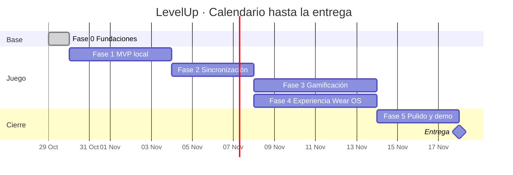

# LevelUp · Roadmap

Este roadmap ordena en fases el trabajo descrito en el [Plan de implementación](PLAN_DE_IMPLEMENTACION.md). Cada fase termina con un entregable que funciona y se puede mostrar.

**Fecha de entrega:** miércoles 18 de noviembre de 2026.

## Resumen

| Fase | Nombre | Fechas | Días | Hito al terminar |
|---|---|---|---|---|
| 0 | Fundaciones | jue 29 oct | 1 | **H1 · Esqueleto listo**: ambas apps compilan con navegación y el motor de XP tiene pruebas |
| 1 | MVP local | vie 30 oct – mar 3 nov | 5 | **H2 · MVP jugable**: se crean y completan misiones en el teléfono y se sube de nivel |
| 2 | Sincronización | mié 4 – sáb 7 nov | 4 | **H3 · Dispositivos conectados**: el reloj recibe misiones y las completa |
| 3 | Gamificación | dom 8 – vie 13 nov | 6 | **H4 · Juego completo**: rachas, insignias, recompensas y celebraciones |
| 4 | Experiencia Wear OS | dom 8 – vie 13 nov | 6 | **H5 · Experiencia wearable**: temporizador y Tile |
| 5 | Pulido y demo | sáb 14 – mar 17 nov | 4 | **H6 · Listo para exponer**: modo demo, guion ensayado y documentación |

**Total:** 3 semanas, del 29 de octubre al 18 de noviembre. El calendario cuenta días naturales, incluidos los fines de semana.

En la Fase 1, el teléfono y el reloj avanzan en paralelo; el reloj trabaja con datos falsos hasta que existe la sincronización. Las fases 3 y 4 también avanzan en paralelo, porque la 3 se concentra en el teléfono y en `:shared`, y la 4 en el reloj.

### Si el calendario se atrasa

Cuando una fase no termina en su fecha, se recorta alcance en este orden y no se mueve la entrega:

1. Tareas *(Could)*: estadísticas T4, Ongoing Activity y recordatorios.
2. Tile del reloj.
3. Tienda de recompensas: se deja solo el saldo de monedas, sin canjes.

No se recortan la sincronización, el temporizador, las celebraciones del reloj ni el modo demo, porque el guion de la exposición depende de ellos.

## Definición de terminado

Una tarea se considera terminada cuando cumple todo lo siguiente:

- [ ] El proyecto compila y `./gradlew test` pasa.
- [ ] Se probó en los emuladores de teléfono y de reloj.
- [ ] Está en una rama `feature/*` con un Pull Request revisado por otro integrante.
- [ ] Los textos visibles están en `strings.xml`.

---

## Fase 0 · Fundaciones

**Fechas:** jueves 29 de octubre · **Completada**

**Objetivo:** dejar la base técnica lista para que los tres integrantes trabajen en paralelo sin bloquearse.

**Ramas:** `feature/shared-core`, `feature/mobile-base`, `feature/wear-base`

**Núcleo y datos**
- [x] Crear el módulo `:shared` (Android library, namespace `com.appw.appwear.shared`) y registrarlo en `settings.gradle.kts`.
- [x] Agregar `implementation(project(":shared"))` en `mobile` y `wear`.
- [x] Actualizar en `gradle/libs.versions.toml` las versiones antiguas de `core-ktx`, `lifecycle-runtime-ktx` y `activity-compose`.
- [x] Agregar al catálogo los plugins de KSP y `kotlinx.serialization`, y las librerías de Room, DataStore, Navigation Compose, `kotlinx-coroutines-play-services` y `kotlinx-serialization-json`.
- [x] Crear los modelos de dominio y enums: `Mission`, `Completion`, `Reward`, `Redemption`, `Difficulty`, `Category`, `Recurrence`, `Verification`.
- [x] Implementar `XpEngine` con sus pruebas unitarias.
- [x] Implementar `StreakEngine` con sus pruebas unitarias.

**Teléfono**
- [x] Definir la identidad visual de LevelUp: paleta, tipografía e ícono.
- [x] Configurar Navigation Compose con barra inferior y las pantallas vacías T1 a T7.

**Reloj**
- [x] Reemplazar el contenido de ejemplo de `MainActivity` por la navegación base con `SwipeDismissableNavHost`.
- [x] Aplicar la paleta de LevelUp al tema del reloj.
- [x] Cambiar `com.google.android.wearable.standalone` a `false` en el manifiesto.

**Criterios de aceptación**
- Ambas apps abren y navegan entre pantallas vacías.
- Las pruebas de `XpEngine` validan la tabla de niveles del plan (nivel 10 = 4 500 XP) y el tope del multiplicador de racha.

---

## Fase 1 · MVP local

**Fechas:** viernes 30 de octubre al martes 3 de noviembre (5 días)

**Objetivo:** el juego funciona completo en el teléfono, y el reloj ya tiene sus pantallas principales.

**Ramas:** `feature/mobile-database`, `feature/mobile-misiones`, `feature/wear-misiones`

**Núcleo y datos**
- [ ] Crear `AppDatabase` con `MissionEntity`, `CompletionEntity`, sus DAOs y los mapeos a los modelos de dominio.
- [ ] Implementar `MissionRepository` y `ProgressRepository`, exponiendo `Flow` para la UI.
- [ ] Crear `LevelUpApp` con el `AppContainer` manual.
- [ ] Impedir que una misión diaria se complete dos veces el mismo día.
- [ ] Vincular los emuladores con **Pair Wearable** y confirmar que el teléfono usa una imagen con Google Play. Se adelanta a esta fase para no descubrir problemas de conexión en la Fase 2.

**Teléfono**
- [ ] T1 Dashboard: nivel, barra de XP y misiones de hoy.
- [ ] T2 Lista de misiones con filtros por categoría.
- [ ] T3 Formulario para crear y editar misiones con validación.
- [ ] Completar una misión `MANUAL` y mostrar la XP ganada.

**Reloj**
- [ ] Crear un `FakeMissionRepository` con datos de ejemplo.
- [ ] R1 Inicio con el anillo de progreso de XP.
- [ ] R2 Misiones de hoy.
- [ ] R3 Detalle de misión con el botón completar.
- [ ] R5 Pantalla de misión cumplida.

**Criterios de aceptación**
- Una misión creada en el teléfono sigue ahí después de cerrar y abrir la app.
- Al completar misiones, la XP y el nivel cambian según las reglas del plan.
- El reloj navega por R1 → R2 → R3 → R5 con datos falsos.
- Los emuladores aparecen vinculados en la app complementaria del teléfono.

---

## Fase 2 · Sincronización

**Fechas:** miércoles 4 al sábado 7 de noviembre (4 días)

**Objetivo:** teléfono y reloj comparten el mismo estado mediante el Data Layer.

**Ramas:** `feature/sincronizacion-telefono`, `feature/sincronizacion-reloj`

**Núcleo y datos**
- [ ] Definir `SyncPaths` y los DTOs `@Serializable` (`ProfileDto`, `MissionDto`, `CompletionEventDto`) en `:shared`.
- [ ] Implementar `StatePublisher` en el teléfono, que publica `/levelup/state/profile` y `/levelup/state/missions` cada vez que cambia el estado.
- [ ] Implementar `PhoneSyncService` (`WearableListenerService`) que procesa los eventos de completado, ignora los `uuid` repetidos y elimina el evento procesado.
- [ ] Registrar los servicios en ambos manifiestos con sus filtros de ruta.

**Reloj**
- [ ] Implementar `WatchStateCache` con DataStore.
- [ ] Implementar `WatchSyncService` que actualiza la caché al recibir estado.
- [ ] Reemplazar `FakeMissionRepository` por un repositorio que lee de la caché.
- [ ] Implementar `EventSender`: completar una misión crea el `DataItem` del evento y muestra la XP de forma optimista.

**Lista de verificación manual**
- [ ] Una misión creada en el teléfono aparece en el reloj en menos de 5 segundos.
- [ ] Una misión completada en el reloj actualiza la XP del teléfono.
- [ ] Con el reloj desconectado se completa una misión; al reconectar, la XP se aplica **una sola vez**.
- [ ] Al reinstalar la app del reloj, recupera el estado actual sin intervención.

**Criterios de aceptación**
- Toda la lista de verificación manual se cumple con los emuladores vinculados.

---

## Fase 3 · Gamificación

**Fechas:** domingo 8 al viernes 13 de noviembre (6 días, en paralelo con la Fase 4)

**Objetivo:** completar las mecánicas de juego y las celebraciones.

**Ramas:** `feature/insignias`, `feature/recompensas`, `feature/wear-celebraciones`

**Núcleo y datos**
- [ ] Implementar `BadgeEngine` con el catálogo del plan y una prueba por regla.
- [ ] Agregar `RewardEntity`, `RedemptionEntity` y `BadgeUnlockEntity` a la base de datos.
- [ ] Calcular monedas y saldo, y aplicar el multiplicador de racha al completar.
- [ ] Enviar `/levelup/notify/badge` al reloj cuando se desbloquea una insignia.

**Teléfono**
- [ ] T5 Galería de insignias.
- [ ] T6 Recompensas: crear, canjear (validando el saldo) e historial.
- [ ] Mostrar la racha y las monedas en T1.
- [ ] *(Could)* T4 Estadísticas: XP de los últimos 7 días.

**Reloj**
- [ ] R6 Subida de nivel con animación y patrón de vibración.
- [ ] Vibración corta en R5.
- [ ] Mostrar la racha y las monedas en R1.
- [ ] Celebración al recibir una insignia desbloqueada.

**Criterios de aceptación**
- Completar la primera misión desbloquea `FIRST_STEP` y el reloj lo celebra.
- No se puede canjear una recompensa sin saldo suficiente.
- Al superar el umbral de nivel, el reloj muestra R6.

---

## Fase 4 · Experiencia Wear OS

**Fechas:** domingo 8 al viernes 13 de noviembre (6 días, en paralelo con la Fase 3)

**Objetivo:** aprovechar las capacidades exclusivas del reloj que usa el guion de la demo.

**Ramas:** `feature/wear-temporizador`, `feature/wear-tile`

**Reloj**
- [ ] R4 Temporizador con `FocusTimerService` en primer plano.
- [ ] Al terminar el temporizador: vibración y evento con `sensorVerified = true`.
- [ ] `LevelTileService`: nivel, barra de XP y siguiente misión pendiente.
- [ ] Refrescar el Tile cada vez que cambia el estado.
- [ ] *(Could)* Ongoing Activity para ver el temporizador en la carátula.

**Teléfono**
- [ ] Permitir en T3 la verificación `TIMER` con su meta en minutos.
- [ ] *(Could)* `ReminderWorker` con WorkManager para el recordatorio diario y solicitud de `POST_NOTIFICATIONS`.

**Criterios de aceptación**
- El temporizador sigue corriendo con la pantalla apagada.
- El Tile muestra el nivel correcto después de completar una misión.

---

## Fase 5 · Pulido y demo

**Fechas:** sábado 14 al martes 17 de noviembre (4 días)

**Objetivo:** dejar el proyecto listo para presentarse.

**Ramas:** `feature/modo-demo`, `feature/pulido`

| Fecha | Actividad |
|---|---|
| sáb 14 nov | Modo demo y revisión de estados vacíos |
| dom 15 nov | Accesibilidad y corrección de errores. **Congelamiento de funciones** al final del día: después solo se corrigen errores. |
| lun 16 nov | README, capturas y video de respaldo |
| mar 17 nov | Ensayo general del guion (al menos dos veces) y presentación |
| mié 18 nov | **Entrega y exposición** |

- [ ] Modo demo en T7 (solo `debug`): perfil a 10 XP de subir de nivel, temporizador de 10 segundos, datos de ejemplo y forzar sincronización.
- [ ] Revisar estados vacíos y mensajes cuando el reloj no está conectado.
- [ ] Revisar accesibilidad: escalas de fuente con `@WearPreviewFontScales` y `contentDescription` en íconos.
- [ ] Actualizar el `README.md`: caso de estudio LevelUp, capturas y enlace a este roadmap.
- [ ] Grabar el video de respaldo.
- [ ] Ensayar el guion de demo del plan al menos dos veces.
- [ ] Preparar la presentación.

**Criterios de aceptación**
- El guion de demo completo funciona de principio a fin en menos de 3 minutos.
- Cualquier integrante puede clonar el repositorio y ejecutar ambas apps siguiendo el README.

---

## Seguimiento

| Hito | Fecha objetivo | Estado |
|---|---|---|
| H1 · Esqueleto listo | jue 29 oct | En revisión |
| H2 · MVP jugable | mar 3 nov | Pendiente |
| H3 · Dispositivos conectados | sáb 7 nov | Pendiente |
| H4 · Juego completo | vie 13 nov | Pendiente |
| H5 · Experiencia wearable | vie 13 nov | Pendiente |
| H6 · Listo para exponer | mar 17 nov | Pendiente |
| **Entrega** | **mié 18 nov** | Pendiente |
